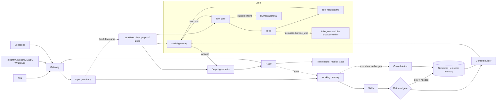

# Architecture

Loopwright is one loop with a harness around it, and one rule that makes it observable: **every step emits an
event**. This page follows a turn through the code. The generated companion, [events.md](events.md), lists every
event kind and the box it lands on.



## One turn

`Agent.run_turn` in [`harness.py`](../loopwright/harness.py) is six calls:

| Call | Steps | What happens |
|---|---|---|
| `_arrive` | scheduler, gateway, input guard | Who started the turn (a person through some door, or a clock) and the one filter on their text |
| `_prepare` | working memory, skills, retrieval gate, memory search, context | Everything that decides what the model will see. Ends with `context.build`, which carries the full prompt and a token count per section |
| `_run_loop` | model, tool gate, tools, tool-result guard, checkpoints | [`loop.py`](../loopwright/loop.py): call the model, run what it asks for, append results, repeat |
| `_review` | critic | Only with `pattern=reflect`: grade the draft, allow one revision |
| `_guard_reply` | output guard | Mask secrets, verify citations |
| `_finish` | reply, save, consolidation, turn checks, receipt, trace | Runs even when the turn failed, so there is always a reply and always a trace |

A message of the form `/workflow <name>` takes a different middle: instead of `_prepare`, `_run_loop` and
`_review`, the harness runs `_run_workflow`, which executes a fixed graph from
[`workflows.py`](../loopwright/workflows.py). The beginning and end are the same, so a workflow is guarded,
traced and replayable like any turn.

A model failure (`ModelError`) and any unexpected exception are both caught in `run_turn`. A turn cannot end
without a message to the user and a trace on disk.

## Design decisions worth knowing

**The event is the unit of everything.** [`events.py`](../loopwright/events.py) defines `Event` with a `stage`
(a box on the board) and a `src` (the box the data came from). The trace file, the cockpit, the CLI printer and
the eval graders are four readers of the same list. Adding a mechanism means emitting an event; a test fails
until a handbook card explains it.

**The model never executes anything.** It returns tool calls as data. [`toolgate.py`](../loopwright/toolgate.py)
answers six questions before a function runs, and every "no" becomes a tool result the model can read, never an
exception.

**Limits live in code, instructions live in the prompt.** The identity prompt asks the model to behave. The
rule that a turn which read untrusted content cannot send a message is an `if` statement in the tool gate. A test
drives the gate with a fully compromised model to show the difference.

**Memory has a separate write path.** Reading is a gate plus a hybrid search. Writing is two stages: extract
candidates (rules offline, one model call otherwise), then resolve each against the store in plain code as ADD,
UPDATE, NOOP or DROP. Facts are superseded, never edited.

**One neutral message format.** The loop speaks `{role, content, tool_calls}`; each provider in
[`models/`](../loopwright/models/) translates at the last moment. The Claude Code adapter has no native channel
for foreign tools, so it describes them in the system prompt and parses one JSON object back.

**A worker is the same loop with a different toolset.** `Agent._work` runs `run_loop` with a fresh context, its
own tool registry and its own gate. Research workers (`delegate`), the browser worker (`browse_web`) and a
workflow's `agent` steps are all that one function. What a worker read taints the turn that receives its summary.

**Who started the turn changes what it may do, and nothing else.** A scheduled task runs the ordinary `run_turn`
with `approvals=deny`. A chat gateway runs it with an approver that asks in words. There is no separate code path
for unattended or remote use to get wrong.

**Every switch is a field on `Options`.** [`config.py`](../loopwright/config.py). The Lab in the cockpit, the
`--set key=value` flag and the eval ablations all set the same fields, which is why an ablation is one line.

## State on disk

Everything is under `~/.loopwright/` (override with `LOOPWRIGHT_HOME`):

```
state.db        SQLite: messages, sessions, facts, episodes, calendar, notes, outbox, tool_log, checkpoints,
                scheduled tasks and results waiting to be delivered to a chat
traces/         one JSONL file per turn; traces/shots/ holds the browser agent's screenshots
workflows/      your workflow files (bundled ones live in the package)
evals/          mine.jsonl: eval cases you saved from your own runs
compare/        the last model comparison and its traces
feedback.jsonl  thumbs up and down on replies
skills/         your skills (bundled ones live in the package)
tools/          your Python tools
mcp.json        MCP servers to connect
settings.json   tools you switched off, and opt-in tools you switched on
IDENTITY.md     your identity prompt, if you replaced it
classroom/      the scratch copy the lessons run in
```
